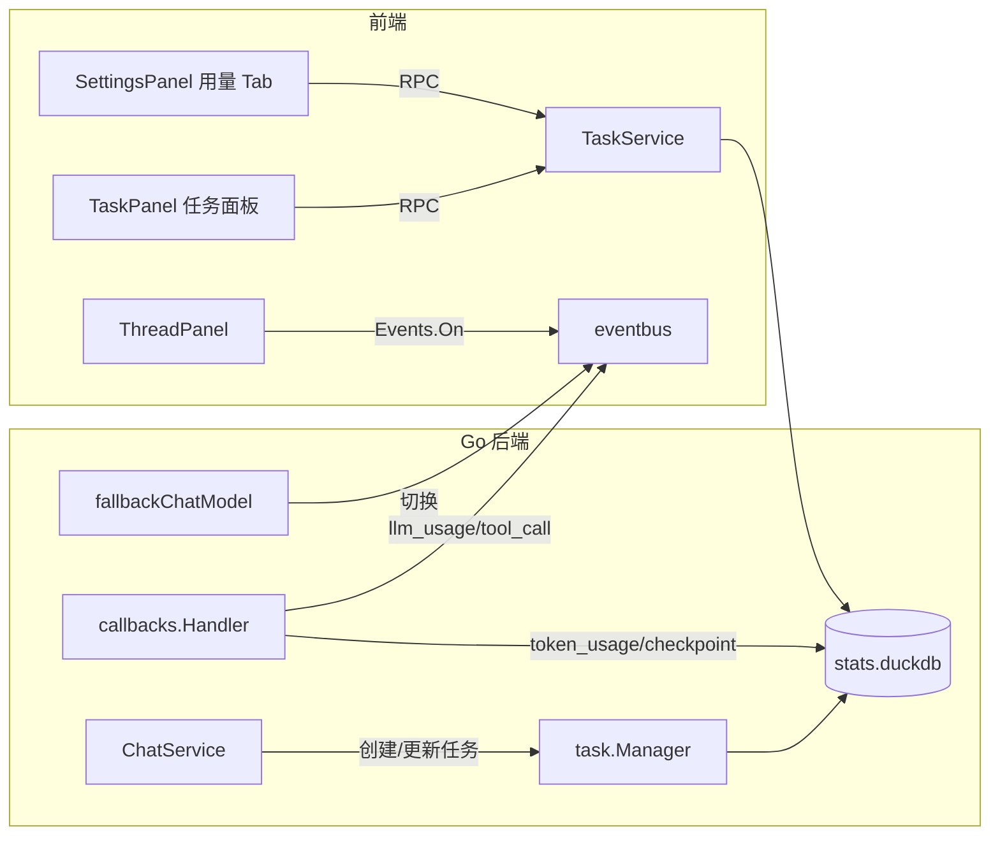

## 产品概述

M5「生产化」：为 ai-dog-agent 补齐生产级能力——任务持久化与完整任务面板、断点级中断恢复、Token 成本统计（DuckDB）、模型故障切换，覆盖 FR-5.1~FR-5.6（OTLP tracing 本期以 DuckDB 统计替代延后）。

## Core Features

- **DuckDB 持久层**：落盘 tasks（任务）、task_events（事件流）、token_usage（Token 用量与成本）、checkpoints（工具级检查点）四张表，单文件数据库，支持日/任务维度聚合报表
- **任务模型与事件流扩展**：一次用户消息触发的执行轮次 = 一个任务（运行/完成/失败/中断四态）；新增 task_state / tool_call / llm_usage / model_fallback 事件类型并实时落库，前端实时渲染
- **完整任务面板**：侧栏新增「任务」视图——任务列表、状态徽标、Token 用量列、历史任务恢复入口；设置页新增「用量」统计 Tab（按日/任务汇总成本）
- **断点级中断恢复**：每个工具调用前后同步落 checkpoint（工具名/参数/结果/消息快照）；中断后可从最后完整检查点精确重放续跑
- **Token/成本统计**：Eino Callback 采集每次 LLM 调用 input/output tokens，按模型单价（PriceIn/PriceOut）折算成本入库
- **模型故障切换**：按模型配置列表顺序构建 fallback 链，网络错误/429/5xx 自动切换下一模型，切换事件上报对话流
- 按任务粒度 git commit（用户已授权）

## Tech Stack

- 持久层：`github.com/marcboeker/go-duckdb/v2`（CGO 已验证可用：CGO_ENABLED=1 + MSYS2 gcc 16.2）；数据库文件 `%AppData%/ai-dog-agent/stats.duckdb`
- 回退预案：若 go-duckdb 在 Windows 编译受阻，回退 `modernc.org/sqlite`（纯 Go）并保持 store 接口不变
- Callbacks：eino v0.9.23 `callbacks.Handler`（global handler 注入，覆盖 LLM 与 Tool 节点）
- 前端：沿用 React + 自定义 CSS（无组件库），Wails bindings 自动生成

## Implementation Approach

- **store 接口化**：`internal/store` 定义 `Store` 接口 + DuckDB 实现，写入走单 goroutine 异步 channel（事件/用量写入低频，不阻塞对话主链路；落库失败仅 slog 警告），查询同步
- **任务生命周期**：`SendMessage` 创建 task(running) → `task_state` 事件；runTurn 结束/出错/取消时更新终态；事件经 eventbus 推送同时入 task_events 表
- **Callbacks 织入**：`callbacks.InitGlobalHandlers` 注入 Handler——LLM OnEnd 读 ResponseMeta.Usage 写 token_usage（按 ModelConfig.PriceIn/PriceOut 折算）+ 发 llm_usage；工具 OnStart/OnEnd 发 tool_call/tool_result 并写 checkpoint（before：args；after：result + 消息快照）。runTurn 现有 collectDelta/chat_done 保留不动
- **断点恢复**：新增 `RecoverTask(taskID)` RPC——定位该任务最后一个 after-checkpoint，用其消息快照重建会话历史并续跑（复用 runTurn 的 historyMessages 回放机制）；恢复事件发 task_state
- **故障切换**：`internal/llm` 新增 fallbackChatModel 装饰器（实现 model.ChatModel）：主模型网络错误/429/5xx 时按 Models 配置顺序切换下一个，切换时发 model_fallback 事件；全部失败返回原错误
- **前端布局**：Sidebar 顶部加「线程 / 任务」Tab 切换，TaskPanel 显示任务列表（状态徽标 + 用量 + 恢复按钮）；设置页加「用量」Tab（日汇总表）。严禁破坏 styles.css 的 min-height:0 收缩链

## Architecture Design



## Directory Structure Summary

```
ai-dog-agent/
├── go.mod                                  # [MODIFY] 新增 go-duckdb/v2 依赖
├── internal/store/
│   ├── store.go                            # [NEW] Store 接口 + Task/TaskEvent/TokenUsage/Checkpoint 结构体
│   ├── duckdb.go                           # [NEW] DuckDB 实现（建表/插入/更新/聚合查询，单连接+互斥）
│   ├── writer.go                           # [NEW] 异步写入器（channel + 单 goroutine，优雅关闭）
│   └── duckdb_test.go                      # [NEW] 建表/CRUD/聚合/日报表单测（临时文件库）
├── internal/task/
│   └── manager.go                          # [NEW] 任务生命周期管理（创建/状态流转/事件记录）
├── internal/eventbus/eventbus.go           # [MODIFY] 新增 EvTaskState/EvToolCall/EvLLMUsage/EvModelFallback 及载荷
├── internal/llm/
│   ├── factory.go                          # [MODIFY] BuildModelChain（按配置顺序构建 fallback 链）
│   └── fallback.go                         # [NEW] fallbackChatModel 装饰器（错误分类切换 + 事件上报）+ 单测
├── internal/agent/
│   ├── chat.go                             # [MODIFY] SendMessage/runTurn 接入任务生命周期；新增 RecoverTask RPC；事件落库
│   ├── callback.go                         # [NEW] eino callbacks.Handler：LLM usage→store+llm_usage；工具→checkpoint+tool_call
│   └── callback_test.go                    # [NEW] handler 单测（fake 节点信息）
├── internal/service/task_service.go        # [NEW] Wails RPC：ListTasks/GetTaskEvents/RecoverTask/GetDailyUsage/GetTaskUsage
├── main.go                                 # [MODIFY] 装配 store/task/TaskService 注册
├── frontend/src/components/
│   ├── TaskPanel.tsx                       # [NEW] 任务列表（状态徽标/用量/恢复入口/点击跳线程）
│   ├── ThreadPanel.tsx                     # [MODIFY] 消费 task_state/tool_call/llm_usage/model_fallback 事件
│   ├── Sidebar.tsx                         # [MODIFY] 「线程/任务」Tab 切换
│   ├── SettingsPanel.tsx                   # [MODIFY] 新增「用量」Tab（日维度成本汇总表）
│   └── styles.css                          # [MODIFY] TaskPanel/用量表/状态徽标样式（保持收缩链）
└── frontend/bindings/                      # [REGEN] wails3 generate bindings
```

## Key Code Structures

```
// internal/store/store.go 核心接口
type Store interface {
    CreateTask(t Task) error
    UpdateTaskStatus(id, status, errMsg string) error
    AppendTaskEvent(taskID, evType string, payload any) error
    AppendTokenUsage(u TokenUsage) error
    AppendCheckpoint(c Checkpoint) error
    LastAfterCheckpoint(taskID string) (*Checkpoint, error)
    ListTasks(limit int) ([]Task, error)
    DailyUsage(days int) ([]DailyUsageRow, error)  // 按 DateTrunc('day') 聚合成本
    Close() error
}
```

## Design Style

延续现有暗色工作台风（Mono 深色面板 + 等宽字体点缀），TaskPanel 与用量 Tab 作为信息密度较高的数据视图：紧凑行距、状态色徽标、数字右对齐。无新框架，纯自定义 CSS，复用现有 CSS 变量（--bg-panel/--border/--green/--yellow/--red/--accent）。

### 任务面板（侧栏 Tab 切换「线程 / 任务」）

- 顶栏：两个小 Tab 按钮（沿用 .review-tab 样式语言）
- 任务行：状态徽标（运行=青色脉冲点 / 完成=绿 / 中断=黄 / 失败=红）+ 任务标题（截断）+ 右侧 Token 数 + 成本小字；hover 高亮，点击跳转对应线程；运行中任务行尾显示「中断」按钮；中断/失败任务显示「恢复」按钮
- 空态文案「暂无任务」

### 设置页「用量」Tab

- 按日汇总表：日期 / 调用次数 / 输入 tokens / 输出 tokens / 成本（元，两位小数）；表尾总计行
- 复用 .model-row/.hint 现有样式体系

### 交互

- task_state 事件实时刷新任务行（本地 state 合并，避免全量拉取）
- 恢复按钮点击后切到对应线程并提示「正在从断点恢复」

## Agent Extensions

### MCP

- **mcp-wails3-dev**
- Purpose: 端到端 UI 验证（任务面板渲染、事件实时刷新、用量 Tab、断点恢复交互、事件流新类型）
- Expected outcome: 运行中应用实测 DOM/事件流，确认任务面板与用量统计按设计工作

### SubAgent

- **code-explorer**
- Purpose: 探索 eino v0.9.23 callbacks API 注入点与 fallbackChatModel 接口约束、sessionStore/StoredMessage 结构
- Expected outcome: callbacks 织入与模型切换的实现方案落到确切 API 签名