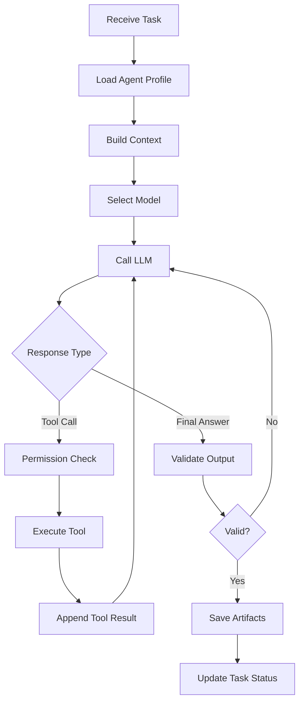

# 多 Agent 协作、Agent Runtime 与任务状态机设计

日期：2026-11-26
状态：阶段 A–E 已实现（2026-11-26）。实施记录见
`docs/superpowers/plans/2026-11-26-multi-agent-runtime.md`。

## 1. 设计理念与已确认决策

- **每个 Agent 在每个项目中拥有唯一 `agent_id`**，随每次 LLM 请求提交，
  用于供应商侧提示词缓存复用与调用隔离。
- **主 Agent 的 `agent_id` 同时作为 `user_id`**（随项目走）；work agent 的
  `agent_id` 独立，`user_id` 统一为主 Agent ID。
- 主 Agent 内置一个**后台优化 Agent（agent-smith）**，负责优化/创造 work agent 的
  提示词、工具、MCP、Skill、Agent 配置。
- **work agent 随项目走**（`agent_id` 固定），提示词、工具、MCP、Skill 随项目走。
- **每个 work agent 可配置独立 LLM 模型**（`Spec.Model`），并支持上下文压缩。
- 主 Agent 负责任务编排、初始化/分派 work agent，并支持 **agent-to-agent 私聊**。
- 每个 work agent 拥有**独立上下文、独立工具集、独立 MCP 集合、独立 Skill 集合**。

已确认的决策：

| 决策 | 结论 |
|---|---|
| `Spec.Model` 找不到 | 回退主 Agent 激活模型并记录警告（不直接不可用） |
| work agent 备用链 | 包含主 Agent 激活模型作为兜底 |
| `Spec.Tools` 为空 | 默认只读集合 |
| agent-smith 归属 | **应用级**，默认使用主模型 |
| 任务状态机终态 | 增加 `CANCELLED` / `FAILED` |
| 成本/Token 计量 | 以 LLM API 返回的 usage 为准，单价仅用于折算金额 |
| 项目专属 MCP/Skill | 允许项目级定义（与全局合并） |
| 上下文压缩阈值 | 按所选模型上下文窗口的比例触发 |

## 2. 当前实现对照

| 设计 | 当前实现 | 差距 |
|---|---|---|
| 每个 Agent 唯一 `agent_id` | 主 Agent：`internal/agent/identity.go`；work agent：`Spec.AgentID` | ✅ 阶段 A |
| `agent_id` / `user_id` 分离 | `extraFields` 分别注入；work agent 用自身 ID + 主 Agent user_id | ✅ 阶段 A |
| work agent 固定 ID、独立模型 | `BuildWorkAgent` + `BuildWorkModelChain` | ✅ 阶段 A |
| work agent 独立上下文/工具/MCP/Skill | `tools.Catalog` + `BuildWorkAgent` | ✅ 阶段 A |
| 主 Agent 编排/初始化 | `buildDispatchTools` 生成 `dispatch_<name>` | ✅ 阶段 A |
| agent-to-agent 私聊 | `AgentRegistry` + `send_message`（同步、120s 超时、深度/循环限制、`agent_message` 事件） | ✅ 阶段 C |
| agent-smith | `Smith` 运行器（主模型建议 + 审批 + 备份 + 自动开关 + 手动 RPC） | ✅ 阶段 D |
| 配置分层（全局/项目级） | `.aidog/main.json` + `mcp_servers.json` + `skills.json`，`Effective` 合并；配置页已按全局/项目分组 | ✅ 阶段 A/E |
| 上下文压缩 | token 估算 + 模型摘要/规则降级 + `context_compressed` 事件；主 Agent 与私聊历史 | ✅ 阶段 E |
| 执行上限（步骤/Token/时间/工具次数/预算/重试） | `Execution` 计数 + `context.WithTimeout` + 结构化 LimitError | ✅ 阶段 A（重试沿用 ADK） |
| 任务状态机 | PENDING/READY/ASSIGNED/RUNNING/BLOCKED/REVIEW/REJECTED/COMPLETED/CANCELLED/FAILED + `Transition` | ✅ 阶段 B |

附带问题（已修复）：原 `internal/agent/instruction.go` 要求分派“项目级子 Agent”但只有
`dispatch_explorer`；现已改为 `internal/agent/prompts.go` 模板化提示词，并按实际构建成功的
work agent 动态生成 `Dispatches`，提示词与工具集一致。

附带问题：`internal/agent/instruction.go` 要求分派“项目级子 Agent”，但工具集只有
`dispatch_explorer`，提示词与工具不一致。

## 3. 目标架构

### 3.1 Agent 分类

| 角色 | 生命周期 | `agent_id` | `user_id` | 模型 | 上下文 |
|---|---|---|---|---|---|
| 主 Agent（orchestrator） | 随会话 | 项目级主 ID（`.aidog/agent_id`） | 同主 ID | 激活模型 + 备用链 | 会话历史（可压缩） |
| work agent（项目级） | 随项目配置，按需实例化 | `Spec.AgentID`（保存时固化） | 主 ID | `Spec.Model`（未配置跟随主链） | 每个 `(session, agent)` 独立 |
| agent-smith（应用级） | 常驻后台 | 固定 smith ID | 主 ID | 默认主模型 | 独立，按触发批次 |

### 3.2 身份与请求体

- `llm.BuildModel` / `BuildModelChain` 增加 `userID` 参数：
  - 主 Agent：`agentID = 主ID`，`userID = 主ID`
  - work agent：`agentID = Spec.AgentID`，`userID = 主ID`
  - smith：`agentID = smithID`，`userID = 主ID`
- `extraFields` 拆成两个字段分别注入；`DisableExtraFields` 仍整体关闭。
- `Spec.AgentID` 由 `agentspec.Save` 固化，不在运行时临时生成。

### 3.3 模型路由

- work agent 通过 `Spec.Model` 选择模型；主 Agent 使用 `ActiveModelID`。
- 匹配顺序：`ModelConfig.ID` → `Name` → `Model`，命中唯一配置作为主模型。
- 未配置：跟随主 Agent 激活模型 + 全局备用链。
- 找不到：回退主 Agent 激活模型并记录警告（已确认）。
- 备用链：所选模型为主，其余全局模型按顺序兜底，且包含主 Agent 激活模型；
  `model_fallback` 事件带 `agentId`。
- 请求体 `agent_id` / `user_id` 与模型选择无关。
- 用量与成本按**实际使用的模型**记录（当前按激活模型单价会失真）。
- 模型变更后已实例化的 work agent 需要重建。

### 3.4 配置分层

配置分**全局**与**项目级**两类：

| 层级 | 位置 | 内容 |
|---|---|---|
| 全局 | `%AppData%/ai-dog-agent/config.json` | 模型（BaseURL/Key/单价/超时）、全局 MCP Server、全局 Skill、激活模型、Shell 白名单 |
| 项目级 | `<workspace>/.aidog/` | work agent（`agents/*.json`）、主 Agent 覆盖（`main.json`）、项目专属 MCP（`mcp_servers.json`）、项目专属 Skill（`skills.json`）、主 Agent ID（`agent_id`） |

- **项目级覆盖全局**：项目级可引用全局定义的 MCP/Skill（按 ID/Name），也可定义项目专属项。
- 项目专属 MCP/Skill 与全局同名/同 ID 时，项目级优先；删除全局项时需处理项目级悬空引用。
- `.aidog/` 可随仓库分发：项目专属 MCP command / Skill 指令等同于可执行配置，
  加载前应提示或要求确认（信任边界）。
- 主 Agent 覆盖（`main.json`）建议字段：
  ```json
  {
    "model": "可选，覆盖激活模型",
    "tools": ["read_file", "dispatch_coder"],
    "skills": ["global-skill", "project-skill"],
    "mcp_servers": ["global-mcp-id"],
    "budget": { "max_steps": 20, "max_tokens": 200000, "max_duration_seconds": 600,
                "max_tool_calls": 40, "max_cost": 2.0, "max_retries": 3 },
    "context": { "compress_threshold": 0.7, "keep_recent": 6 }
  }
  ```
- work agent `Spec` 增加：
  ```json
  {
    "agent_id": "…",
    "name": "coder",
    "model": "deepseek-chat",
    "tools": ["read_file", "write_file", "go_test"],
    "skills": ["go-review"],
    "mcp_servers": ["local-fs"],
    "max_turns": 12,
    "budget": { "max_steps": 12, "max_tokens": 150000, "max_duration_seconds": 600,
                "max_tool_calls": 30, "max_cost": 1.5, "max_retries": 3 },
    "context": { "compress_threshold": 0.7, "keep_recent": 6 }
  }
  ```
- 配置页对应拆成两组：
  - **全局设置**：模型 / 全局 MCP / 全局 Skill / 外观 / 安全 / 用量。
  - **项目设置**：work agent、主 Agent 覆盖（工具/MCP/Skill/模型/预算/压缩）、
    项目专属 MCP/Skill（可选）、项目预算与压缩阈值。
- 当前 `SettingsPanel` 的 Tab 需要按来源分组或标注“全局/项目”。

### 3.5 work agent 运行时

按 `Spec` 构建独立的 `adk.ChatModelAgent`：

- **模型**：按 3.3 路由；构建链时使用 `Spec.AgentID` + 主 ID + 选中的模型。
- **指令**：`Spec.SystemPrompt`（稳定前缀）+ 该 Agent 的 Skills 指令 + 项目上下文尾部。
- **工具**：按 `Spec.Tools` 从 registry 选择；为空时只读（已确认）。
  - 只读：`read_file` / `list_files` / `search_code` / `git_diff` / `git_status`
  - 写：`write_file` / `edit_file`（审批，归属调用方 session）
  - 执行：`run_shell` / `go_test` / `go_vet` / `go_build`
- **MCP**：按 `Spec.MCPServers` 过滤 `mcpMgr.Tools`，只连接/暴露声明的 server。
- **上下文**：每次 dispatch 独立 Run；私聊由 Registry 按 `(session, agent)` 保持。
- **轮数**：`Spec.MaxTurns` + Runtime 的 `max_steps` 双重限制。

### 3.6 主 Agent 分派

- 为每个 `Spec` 生成 `dispatch_<sanitized_name>` 工具（`adk.NewAgentTool`）。
- 主 Agent instruction 由“项目 Agent 列表”动态生成，工具名与配置一致。
- 分派调用携带任务上下文（目标、相关文件、约束），返回 work agent 的结果摘要。
- explorer 保留为内置 work agent（只读），可被项目配置覆盖/禁用。

### 3.7 agent-to-agent 私聊

- 新增 `send_message(to, content)` 工具，主 Agent 与 work agent 均可调用。
- `AgentRegistry`：`(sessionID) -> map[agentID]*agentSession`，持有 runner、历史、
  inbox、运行状态。
- 第一版同步：等待目标完成并返回结果，带超时与取消；异步 inbox 后续增强。
- 防递归：限制私聊深度（例如 4 层）与同一对 Agent 的重复调用。
- 并发：同一 `(session, agent)` 串行，不同 Agent 可并行。
- 事件：私聊消息进入事件流，展示来源/目标 Agent。

### 3.8 agent-smith

- 应用级后台 Agent（已确认），默认使用主模型，`agent_id` 固定、`user_id = 主ID`。
- 输入：任务事件、失败/中断记录、当前 `.aidog/agents/*.json`、Skills/MCP 配置。
- 输出：新增/修改 work agent 配置；写操作走审批，`agentspec.Save` 已是原子写。
- 触发：任务结束（失败/中断优先）、手动“优化 Agent”按钮。

### 3.9 上下文压缩

- 每个 Agent 独立计数：消息 token 估算超过 `模型窗口 × compress_threshold`
  （默认 0.7）或消息数超限时触发。模型窗口取自 `ModelConfig.ContextWindow`
  （`ModelConfig` 需新增该字段）；未配置时按保守默认（如 32k）估算。
- 策略：保留系统提示词、最近 `keep_recent` 轮、工具结果摘要；更早历史由模型生成摘要
  （失败时降级为规则截断）。
- 在 Runtime 的「Build Context」步骤执行；压缩后写回会话/Registry，并推送
  `context_compressed` 事件（agentId、压缩前后 token）。
- 压缩本身消耗预算，需要计入 `max_tokens` / `max_cost`，并限制触发频率。
- 风险：摘要丢失关键约束；工具调用/结果的配对关系需要保留或安全丢弃。

### 3.10 Agent Runtime 执行引擎（核心）

采用 **Tool Calling Agent Loop**：



职责：

1. 加载 Agent Profile（主/工作/smith）。
2. 加载任务上下文（会话历史、项目上下文、压缩后的摘要）。
3. 选择模型（3.3 路由）。
4. 构建系统提示词（稳定前缀 + 动态尾部）。
5. 请求大模型（流式转发事件）。
6. 解析模型输出（文本 / tool call）。
7. 处理工具调用（权限检查 → 审批 → 执行）。
8. 返回工具执行结果（追加到上下文）。
9. 继续模型推理。
10. 达到完成条件后结束任务（保存产物、更新状态）。

执行上限（每次 Agent 执行都必须设置，禁止无限循环）：

| 限制 | 默认建议 | 超限行为 |
|---|---|---|
| 最大执行步骤 `max_steps` | 12（主 20） | 终止并输出“未完成原因” |
| 最大 Token `max_tokens` | 150k（主 200k） | 终止，保留已产出内容；累计值来自 API `usage` |
| 最大执行时间 `max_duration` | 600s | ctx 取消，子进程终止 |
| 工具调用次数 `max_tool_calls` | 30（主 40） | 终止 |
| 单任务预算 `max_cost` | 1.5 元（主 2 元） | 终止，提示预算；金额优先用 API 返回成本 |
| 错误重试 `max_retries` | 3 | 终止并上报 |

计量来源：

- 每次 LLM 调用的 `usage`（`prompt_tokens` / `completion_tokens`）是**唯一事实来源**，
  不按字符数估算扣预算。
- OpenAI 兼容的流式请求需要 `stream_options.include_usage=true`，否则末尾没有 usage。
  已确认 eino openai 的 `ExtraFields` 会合并进请求体（`chatmodel.go`），可注入该字段；
  但非流式请求是否接受 `stream_options` 取决于端点，建议按供应商开关或复用
  `DisableExtraFields`。
- 部分供应商在响应里直接返回成本（如 `usage.cost`），优先使用它；
  缺失时按 `ModelConfig.PriceIn/PriceOut` 折算。
- 完全没有 usage 时：不扣减预算、记录警告（不能把未知成本当 0 静默通过）。

实现要点：eino ADK 的 `MaxTurns`/`ModelRetryConfig` 只能覆盖部分限制；
步骤、工具次数、Token、成本需要在 Runtime 外层计数（callback/ctx 取消），
超限统一返回结构化错误（例如 `ErrBudgetExceeded` / `ErrMaxSteps`）。

### 3.11 任务状态机

```text
PENDING → READY → ASSIGNED → RUNNING → REVIEW → COMPLETED
                                  │  ↑        │
                                  │  └ REJECTED
                                  ├→ BLOCKED（等待审批/外部输入）→ RUNNING
                                  ├→ CANCELLED（用户取消，终态）
                                  └→ FAILED（不可重试失败，终态）
```

| 状态 | 含义 | 触发 |
|---|---|---|
| PENDING | 已创建，等待调度 | 用户提交 / 分派创建 |
| READY | 依赖/上下文就绪 | 调度器检查通过 |
| ASSIGNED | 已分配给某 Agent | 主 Agent 分派 |
| RUNNING | 执行中 | Runtime 开始 |
| BLOCKED | 等待审批或外部输入 | 审批请求 / 用户中断 |
| REVIEW | Agent 完成，待校验 | 最终答案校验前 |
| REJECTED | 校验失败/被拒 | 输出校验失败 / 人工拒绝 |
| COMPLETED | 完成 | 校验通过、产物保存 |
| CANCELLED | 用户主动取消（终态） | 用户中断 |
| FAILED | 不可重试失败（终态） | 预算/步骤超限、不可恢复错误 |

与现有实现（`store.StatusRunning/Completed/Failed/Interrupted`）的映射：

- `running` → `RUNNING`
- `completed` → `COMPLETED`
- `interrupted` → `CANCELLED`（用户中断）
- `failed` → `FAILED`（不可重试）或 `REJECTED`（可重试，再回到 `RUNNING`）

`CANCELLED` / `FAILED` 为已确认新增终态，需要迁移旧数据与前端展示。

状态迁移需要持久化（`tasks.status`），前端 TaskPanel 按新状态展示；
审批等待对应 `BLOCKED`，审批通过回到 `RUNNING`。

## 4. 接口改动清单

| 模块 | 改动 |
|---|---|
| `internal/llm` | `BuildModel`/`BuildModelChain` 增加 `userID`；`extraFields` 拆分；`ResolveModel(cfg, Spec.Model)`；用量按 API usage 记录实际模型与实际成本 |
| `internal/agentspec` | `Spec` 增加 `Budget` / `Context`；运行时消费 `AgentID/Model/Tools/Skills/MCPServers/MaxTurns`；校验模型/工具名 |
| `internal/config` | 全局配置与项目级覆盖（`main.json` / `mcp_servers.json` / `skills.json`）合并；`ModelConfig.ContextWindow`；配置版本 |
| `internal/agent` | 新增 `AgentRuntime`、`AgentRegistry`、`BuildWorkAgent`、`dispatch_<name>`、`send_message`；动态 instruction |
| `internal/task` | 状态机（PENDING/READY/ASSIGNED/RUNNING/BLOCKED/REVIEW/REJECTED/COMPLETED + CANCELLED/FAILED）；`Transition` |
| `internal/store` | `tasks.status` 扩展；`context_compressed` 事件；用量记录 modelID 与实际成本（API usage 优先） |
| `internal/mcp` | `Tools` 支持按 server 子集过滤 |
| `internal/eventbus` | 事件增加 `agentId`、`modelID`；分派/私聊/压缩事件 |
| 前端 | 配置页按全局/项目分组；任务状态展示；私聊/压缩/Agent 来源展示 |

## 5. 关键决策与取舍

| 决策 | 取舍 |
|---|---|
| `agent_id` 与 `user_id` 分离 | 缓存隔离正确；改 model 工厂签名，影响所有构建点 |
| work agent 每次 dispatch 独立上下文 | 隔离干净、实现简单；跨任务延伸依赖私聊/Registry |
| 私聊第一版同步 | 简单、可直接返回；长任务占用调用方，需要超时/取消 |
| 同一 `(session, agent)` 串行 | 避免上下文竞争；并行度降低 |
| `Spec.Tools` 为空只读 | 安全默认（已确认） |
| `Spec.Model` 找不到回退主模型 | 可用性优先（已确认）；用警告日志暴露配置错误 |
| 备用链包含主激活模型 | 兜底更强（已确认）；可能掩盖 work agent 模型故障 |
| smith 应用级、默认主模型 | 跨项目复用分析能力（已确认）；配置变更仍按项目落盘 |
| 任务状态机终端态 | 增加 `CANCELLED` / `FAILED`（已确认）；需要迁移旧状态与前端适配 |
| 成本按 API usage | 真实、可对账（已确认）；供应商不返回 usage 时不扣预算并告警 |
| 项目级 MCP/Skill | 允许项目专属定义（已确认）；`.aidog/` 随仓库分发，需信任提示 |

## 6. 分阶段计划

### 阶段 A：Agent Runtime + work agent 运行时（核心）

1. `llm` 拆分 `agent_id`/`user_id`，补 httptest 断言。
2. 模型路由：`Spec.Model` 选择 + 备用链（含主模型）+ 用量按实际模型。
3. 配置分层：全局/项目级（含项目专属 MCP/Skill）合并 + `Spec.Budget/Context` + `ModelConfig.ContextWindow`。
4. `AgentRuntime`：10 步 loop + 六项执行上限 + 结构化超限错误。
5. `BuildWorkAgent`：独立模型/指令/工具/MCP/Skill/MaxTurns。
6. 主 Agent 动态 `dispatch_<name>`；instruction 与工具集一致。
7. 回归测试：身份注入、模型路由、工具白名单、MCP 过滤、上下文隔离、上限终止。

### 阶段 B：任务状态机

1. 扩展状态与 `Transition`，迁移现有 running/completed/failed/interrupted，新增 CANCELLED/FAILED 终态。
2. 审批请求 → BLOCKED，审批结果 → RUNNING/REJECTED。
3. 前端 TaskPanel 展示新状态。
4. 回归测试：合法/非法迁移、审批阻塞、终态。

### 阶段 C：agent-to-agent 私聊

1. `AgentRegistry` 与会话保持。
2. `send_message`（同步 + 超时/取消 + 深度限制）。
3. 事件流与前端展示。
4. 回归测试：主→work、work→work、递归限制、并发串行。

### 阶段 D：agent-smith

1. 应用级后台触发（任务结束/手动）。
2. 读取任务/配置，生成/修改 `Spec`（审批）。
3. 回归测试：配置生成、审批拒绝、回滚。

### 阶段 E：上下文压缩 + 配置页

1. 上下文 token 估算与压缩策略。
2. 压缩事件与持久化。
3. 配置页全局/项目分组、项目专属 MCP/Skill、预算/压缩阈值编辑。
4. 回归测试：阈值触发、摘要失败降级、压缩后可用性。

## 7. 风险与开放问题

- **改动面大**：`llm` 签名、`agent` 装配、`task` 状态、`eventbus`、前端都受影响，需分阶段提交。
- **状态机迁移**：现有 `failed`/`interrupted` 映射到 `FAILED`/`CANCELLED`，旧数据需要迁移与兼容展示。
- **上限实现**：ADK 的 `MaxTurns` 只覆盖循环次数；步骤/工具次数/Token/成本需外层计数与 ctx 取消。
- **Token 估算精度**：不同模型 tokenizer 不同，压缩阈值需要保守估计。
- **上下文增长**：Registry 长期持有 work agent 历史，需要上限/淘汰策略。
- **私聊递归/死锁**：A→B→A 需要深度限制与取消传播。
- **审批归属**：work agent 的写/执行审批卡片需要显示发起 Agent。
- **MCP 连接数**：每个 work agent 独立集合可能启动多个子进程，需要复用策略。
- **配置分层冲突**：项目级覆盖全局时的合并规则、删除全局项后的悬空引用。
- **模型能力差异**：work agent 的工具 schema/提示词可能超出所选模型上下文窗口。
- **成本统计**：金额优先用 API 返回的成本，缺失时按单价折算；供应商不返回 usage 时无法扣减预算（记录告警）。
- **usage 缺失**：部分 OpenAI 兼容端点流式不返回 usage，需显式 `stream_options.include_usage`，否则预算控制失效。
- **项目级配置信任边界**：`.aidog/` 可被仓库携带，MCP command/Skill 指令等同可执行配置，需要审批/提示。

## 8. 本轮未做

- 未改任何代码。
- 未新增/修改 `.aidog/agents/*.json` 的运行时行为。
- 未迁移任务状态。
- 未提交（仅修改本文档）。
